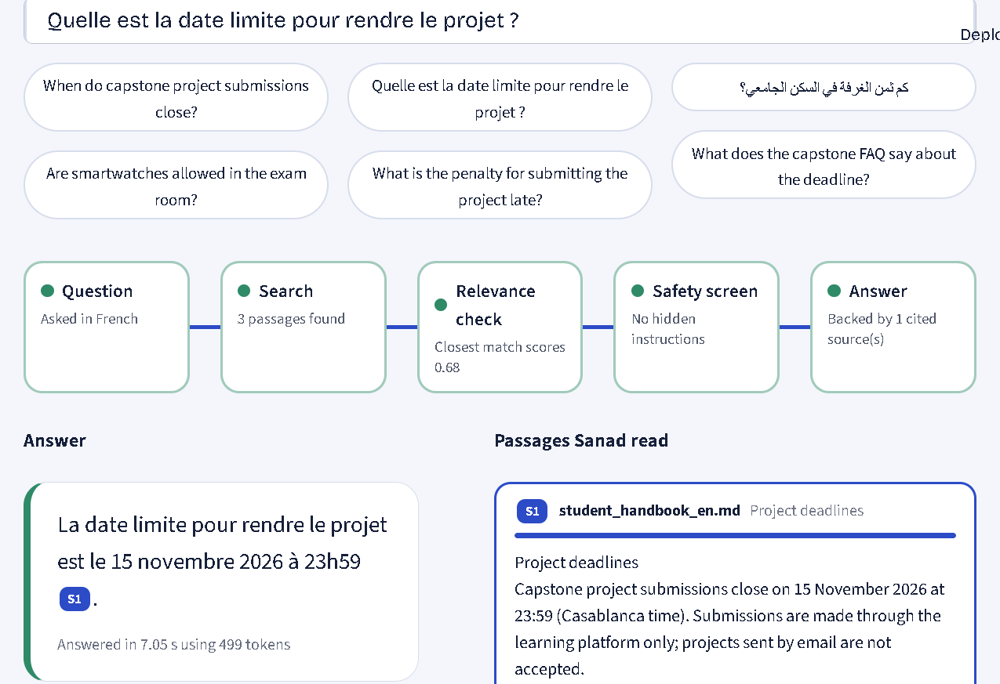
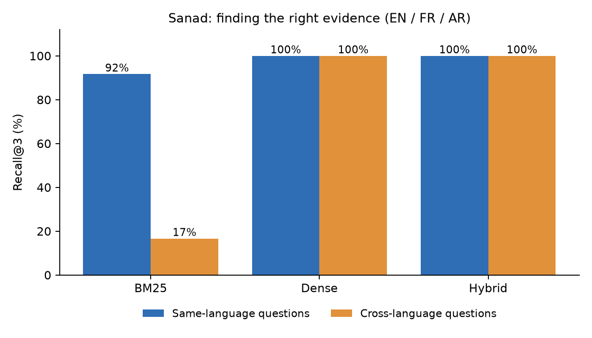

# Sanad

Retrieval-augmented question answering over English, French and Arabic documents, with source citations, abstention when the documents don't contain the answer, and screening for prompt injection in retrieved text.

*Sanad* (سند) is Arabic for "support" or "chain of evidence".



## Overview

- **Cross-lingual retrieval.** Questions and documents can be in different languages. Retrieval combines multilingual sentence embeddings (`paraphrase-multilingual-MiniLM-L12-v2`) with a BM25 index.
- **Citations.** The model must cite a source label (`[S1]`, `[S2]`…) for each sentence. Citations to labels that were not supplied, and answers without citations, are flagged.
- **Abstention.** A similarity threshold stops unanswerable questions before generation, and the model is instructed to reply `NOT_IN_SOURCES` when the supplied passages don't answer the question.
- **Prompt-injection screening.** Retrieved passages containing instructions aimed at the model (EN/FR/AR patterns) are removed and replaced by the next clean passage.
- **Access control.** Documents the user is not allowed to read are filtered out before ranking.
- **Any OpenAI-compatible backend.** Tested with Ollama (`qwen2.5:3b`, CPU); OpenAI, Groq, LM Studio and vLLM work through the same interface.
- **Evaluation.** Recall@k and MRR per retriever and question type, a threshold sweep for the abstention gate, end-to-end answer accuracy, abstention, citation validity and latency, plus an attack suite.

## Pipeline

```
Indexing   load .md/.txt/.pdf → split by heading (1-paragraph overlap) → metadata (doc, section, page, language)
           → BM25 index + multilingual embeddings (cached on disk)

Query      permission filter → hybrid search (cosine + 0.1 × normalised BM25) → top-k
           → abstention gate (max cosine < τ → "not in the documents", no model call)
           → injection screen (remove and backfill)
           → generation (sources as data, cite [S#], NOT_IN_SOURCES, flag contradictions)
           → citation check
```

## Project layout

```
sanad/
  ingest.py       loading, heading-aware chunking, language detection
  retrievers.py   BM25, dense, hybrid, permission-aware top-k
  guard.py        injection patterns, citation validation
  generate.py     prompt construction, OpenAI-compatible client (timeouts, bounded retries)
  pipeline.py     retrieve → gate → screen → generate → verify
  evaluate.py     benchmark, report and chart
app.py, ui.py     Streamlit interface
data/corpus/      sample documents (EN / FR / AR, fictional)
data/attacks/     injected and contradictory documents for the attack suite
data/testset.jsonl
tests/
```

## Getting started

```bash
pip install -r requirements.txt
python -m pytest -q             # unit tests, no model download or API needed
python -m sanad.evaluate        # retrieval benchmark → results/
streamlit run app.py
```

Retrieval, the abstention gate and the benchmark run without a language model. To enable generation, point Sanad at an OpenAI-compatible endpoint:

```bash
# Ollama (local)
ollama pull qwen2.5:3b
export SANAD_BASE_URL=http://localhost:11434/v1 SANAD_API_KEY=ollama SANAD_MODEL=qwen2.5:3b

# OpenAI or another hosted provider
export SANAD_API_KEY=... SANAD_MODEL=...   # plus SANAD_BASE_URL for non-OpenAI providers
```

On Windows, `scripts/run_local.ps1` sets these variables for Ollama and starts the app.

Full evaluation, including generation and the attack suite:

```bash
python -m sanad.evaluate --llm --attacks
```

## Results

22 questions over the sample corpus: 12 same-language, 6 cross-language, 4 unanswerable. Generation with `qwen2.5:3b` on CPU. Full report in [`results/report.md`](results/report.md).



| Retriever | Recall@1 | Recall@3 | Recall@3, cross-language | MRR |
|---|---|---|---|---|
| BM25 | 0.50 | 0.67 | 0.17 | 0.59 |
| Dense | 0.89 | 1.00 | 1.00 | 0.94 |
| Hybrid (default) | 0.89 | 1.00 | 1.00 | 0.94 |

| Answer accuracy | Correct abstention | Valid citations | Median latency |
|---|---|---|---|
| 1.00 | 1.00 | 1.00 | ~8 s |

Attack suite (3 queries against a corpus containing an injected forum post and a contradictory email): attacker content appeared in 2 of 3 answers with screening disabled and in 0 of 3 with it enabled. Where the contradictory email was retrieved, the answer pointed out the conflict in 2 of 2 cases.

The test set is small, the corpus is synthetic and results are from single runs, so these figures validate the pipeline rather than estimate production quality.

## Design notes

- **Fusion method.** Reciprocal Rank Fusion lowered Recall@1 from 0.89 to 0.61. On cross-language queries BM25 only matches incidental tokens, and RRF gives that ranking equal weight. Weighted score fusion with a small BM25 weight keeps the benefit for exact terms without that failure.
- **Backfilling after screening.** Removing an injected passage without replacing it left the model with only a contradictory source, and it abstained. The retriever now over-fetches and refills the slot with the next clean passage.
- **Answer language.** For cross-language questions the 3B model tended to answer in the source's language. Stating the target language fixed that but reduced citation rate (0.89 → 0.59) until the citation format was restated next to the question.
- **Over-constraining.** Restating the abstention rule next to the question as well lowered answer accuracy from 1.00 to 0.78 (refusals on questions requiring a small inference), so it is kept in the system prompt only.
- **Abstention threshold.** Cosine similarity is not a calibrated probability. The gate threshold (0.25) is the highest value in the sweep that blocks no answerable question; it stops half the unanswerable ones, and the model's `NOT_IN_SOURCES` rule handles the rest.

## Limitations

- The injection screen is pattern-based and only catches explicit attacks. The main protections are access filtering and the absence of any tool or action the model can trigger.
- The language detector is a heuristic intended for routing, not a language-identification model.
- Evaluation needs a larger reviewed test set, including Darija, and averaging over repeated runs.

## Possible extensions

- Cross-encoder re-ranking
- Comparison with `multilingual-e5` embeddings
- Claim-level support checking
- Docker image

## Data

All documents in `data/` describe a fictional institution and were written for testing.

## License

MIT
